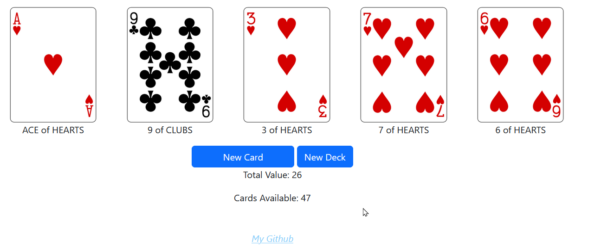

# CardPull

Card Pull creates a deck of cards and pulls them five at a time. 
The hand total is also shown at the bottom. 
I use the [DeckOfCards API](https://deckofcardsapi.com/)

You can try it [here](https://cardpull.netlify.app/)
